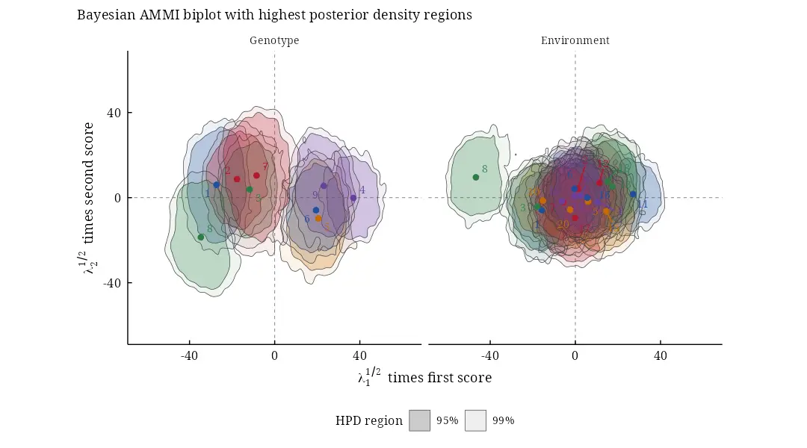
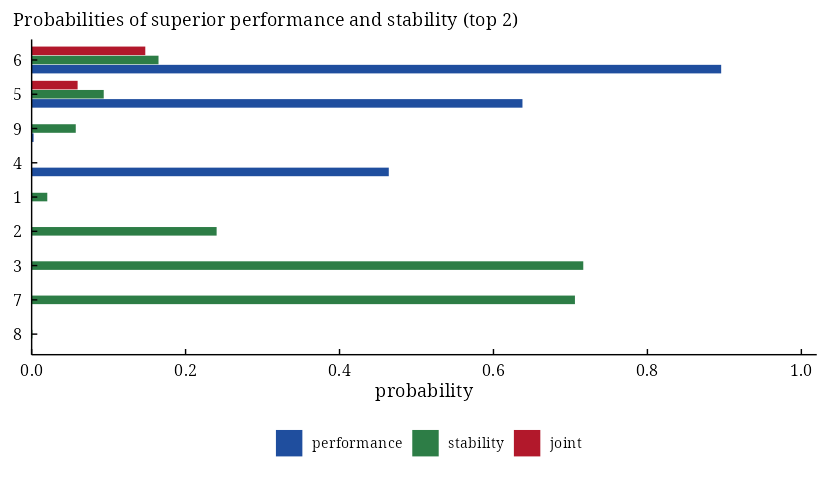
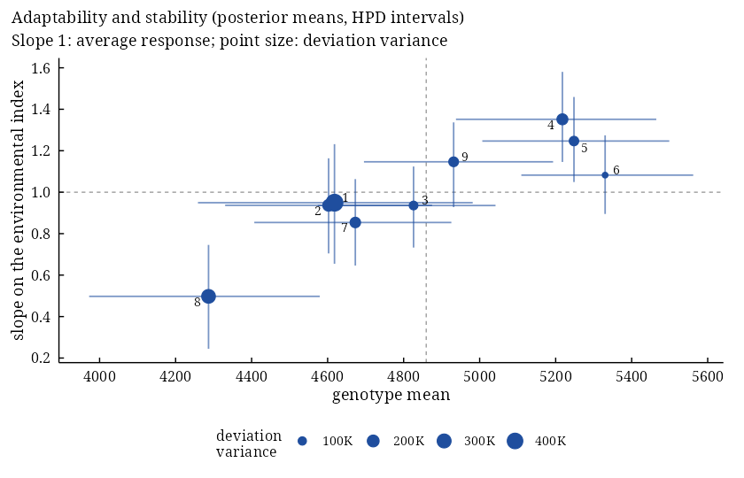

# bayesammi: Bayesian Estimation of the Additive Main Effects and Multiplicative Interaction Model


[](https://CRAN.R-project.org/package=bayesammi)
[](https://cran.r-project.org/web/checks/check_results_bayesammi.html)
[](https://CRAN.R-project.org/package=bayesammi)
[](https://CRAN.R-project.org/package=bayesammi)
[](https://myaseen208.r-universe.dev/bayesammi)
[](https://github.com/myaseen208/bayesammi/actions/workflows/R-CMD-check.yml)
[](https://github.com/myaseen208/bayesammi)
[](https://cran.r-project.org/)
[](https://CRAN.R-project.org/package=bayesammi)
[](https://www.gnu.org/licenses/old-licenses/gpl-2.0.html)
[](https://www.repostatus.org/#active)
[](https://github.com/myaseen208/bayesammi/commits)

## Overview

**bayesammi** estimates the additive main effects and multiplicative
interaction (AMMI) model of multi-environment trials by the Gibbs
sampler of Crossa et al. (2011). Every parameter has a posterior
distribution, so the AMMI biplot gets statistical inference: highest
posterior density (HPD) regions show which genotypes and environments
interact significantly and which form homogeneous groups.

- `bayes_ammi()`: the Gibbs sampler (overall mean, genotype and
  environment effects, singular values, scores on the constrained
  spheres, error variance), with several chains, burn-in, thinning,
  priors from `bam_priors()`, posterior summaries with HPD intervals and
  the convergence diagnostics of Raftery-Lewis, Heidelberger-Welch and
  Gelman-Rubin;
- `biplots()`: the biplot with HPD regions of the genotype and
  environment coordinates;
- `ge_ammi()`, `ge_mean()`, `ge_eff()` and friends: least-squares AMMI
  and the tables it is built on;
- `bam_interpret()`: a plain-language interpretation of every result,
  computed from its numbers.

Beyond the article:

- unbalanced trials (missing plots and empty cells, by data
  augmentation) and environment-specific error variances
  (`.het = TRUE`);
- the Bayesian GGE (sites regression) model (`.model = "GGE"`) and
  `bam_winners()`, the probability that each genotype wins in each
  environment;
- decisions for breeders: `bam_superiority()` (probabilities of superior
  performance and stability of Dias et al. 2022), `bam_ranks()`,
  `bam_stability()` (Bayesian AMMI stability value and interaction
  variance) and `bam_predict()` (every cell, observed or not);
- Bayesian stability analysis: `bayes_stability()` fits the
  Finlay-Wilkinson, Eberhart-Russell and Shukla models by Gibbs sampling
  (slopes, deviation and stability variances, Eskridge’s safety-first
  index, all with HPD intervals); `bam_indices()` and
  `bam_ammi_indices()` give the posterior distributions of Wricke’s,
  Shukla’s, Lin and Binns’, Annicchiarico’s and Eskridge’s indices and
  of ASV, SIPC, EV, Za, WAAS and WAASY;
- model choice: DIC and WAIC with `bam_compare()`, posterior predictive
  checks with `bam_ppc()`, and the draws for **posterior**,
  **bayesplot** and **coda**;
- `bam_app()`: an application that runs every analysis without code,
  with results that copy cleanly.

Version 1.0.0 rewrites the sampler of version 0.3.0, which, among other
faults, never updated the singular values and did not return the error
variance (see NEWS). The new sampler runs in C++ and reproduces Tables 1
and B1 of Crossa et al. (2011). Every function keeps its name, arguments
and result components; fifteen vignettes come in HTML and PDF. Every
printed result ends with the sources of its method; `bam_cite()` gives
them as BibTeX.

## Installation

``` r
install.packages("bayesammi")
# development version
# install.packages("remotes")
remotes::install_github("myaseen208/bayesammi")
```

## Quick start

``` r
library(bayesammi)
data(Maiz)
fit <-
  bayes_ammi(
      .data   = Maiz
    , .y      = y
    , .gen    = entry
    , .env    = site
    , .rep    = rep
    , .nIter  = 3000
    , .k      = 2
    , .burnin = 500
    , .thin   = 1
    , .chains = 2
    , .priors = bam_priors(
          mu_mean     = 0
        , mu_var      = 1e+8
        , tau_mean    = 0
        , tau_var     = 1e+8
        , delta_mean  = 0
        , delta_var   = 1e+8
        , lambda_mean = 0
        , lambda_var  = 1e+8
        , nu          = 1
        , s2          = NULL
        )
    , .level  = 0.95
    , .seed   = 1
    , .align  = TRUE
    , .model  = "AMMI"
    , .het    = FALSE
    , .waic   = TRUE
    )
fit$summary[block %in% c("mu", "sigma2", "lambda")]
```

       parameter  block label axis       mean         sd       mc_se        lower
    1:        mu     mu         NA   4858.071    31.8860   0.4116465   4795.71823
    2:    sigma2 sigma2         NA 762170.002 43547.0839 737.6230979 680191.01282
    3: lambda[1] lambda          1   5459.383   462.2078   6.5519088   4526.53731
    4: lambda[2] lambda          2   1695.053   770.6989  30.0725905     59.23157
            upper       ess      rhat
    1:   4920.000 6000.0000 1.0000264
    2: 849256.062 3485.3720 1.0004346
    3:   6305.934 4976.6695 1.0006729
    4:   2891.761  656.7918 0.9999747

``` r
bp <-
  biplots(
      model         = fit
    , burnin        = 0
    , thin          = 0.5
    , pb            = c(0.05, 0.01)
    , plot_stable   = TRUE
    , plot_unstable = TRUE
    , ncolors       = 5
    , .which        = "both"
    , .grid         = 100
    )
bp$biplot
```



Which genotypes are likely to be among the best two, and stable?

``` r
sp <-
  bam_superiority(
      fit           = fit
    , .s            = 0.2
    , higher_better = TRUE
    )
sp$marginal
```

       Gen     mean prob_performance prob_stability   prob_joint
    1:   6 5331.377        0.8958333     0.16483333 0.1476631944
    2:   5 5247.055        0.6376667     0.09366667 0.0597281111
    3:   9 4927.836        0.0025000     0.05733333 0.0001433333
    4:   4 5217.619        0.4640000     0.00000000 0.0000000000
    5:   1 4615.315        0.0000000     0.02033333 0.0000000000
    6:   2 4604.674        0.0000000     0.24033333 0.0000000000
    7:   3 4824.549        0.0000000     0.71666667 0.0000000000
    8:   7 4670.736        0.0000000     0.70583333 0.0000000000
    9:   8 4283.482        0.0000000     0.00100000 0.0000000000

``` r
plot(x = sp, which = "marginal")
```



Adaptability and stability by the Bayesian Eberhart-Russell model:

``` r
fs <-
  bayes_stability(
      .data   = Maiz
    , .y      = y
    , .gen    = entry
    , .env    = site
    , .rep    = rep
    , .model  = "ER"
    , .nIter  = 3000
    , .burnin = 500
    , .thin   = 1
    , .chains = 2
    , .priors = bam_stab_priors(
          mu_var = NULL
        , g_var  = NULL
        , h_var  = NULL
        , b_var  = 100
        , nu     = 1
        , s2     = NULL
        , nu_d   = 1
        , s2_d   = NULL
        )
    , .level  = 0.95
    , .alpha  = 0.05
    , .seed   = 1
    , .waic   = TRUE
    )
plot(x = fs, which = "slopes")
```



The same analyses without code:

``` r
bam_app(
    launch.browser = TRUE
  )
```

## Learn more

- Vignettes: `browseVignettes("bayesammi")`, starting with
  `bayesammi_01_getting_started`; PDF versions on the site.
- Site: <https://myaseen208.com/bayesammi/>
- Notation: `bam_notation()`
- References of the methods behind a result: `bam_cite()`

## Citation

    Yaseen M, Crossa J, Perez-Elizalde S, Jarquin D, Cotes JM, Viele K, Liu
    G, Cornelius PL, Abadillo Velasco JG (2026). _bayesammi: Bayesian
    Estimation of the Additive Main Effects and Multiplicative Interaction
    Model_. R package version 1.0.0 (first released 2018),
    <https://CRAN.R-project.org/package=bayesammi>.

BibTeX:

    @Manual{bayesammi,
      title = {{bayesammi}: Bayesian Estimation of the Additive Main Effects and Multiplicative Interaction Model},
      author = {Muhammad Yaseen and Jose Crossa and Sergio Perez-Elizalde and Diego Jarquin and Jose Miguel Cotes and Kert Viele and Genzhou Liu and Paul L. Cornelius and Julian Garcia {Abadillo Velasco}},
      year = {2026},
      note = {R package version 1.0.0 (first released 2018)},
      url = {https://CRAN.R-project.org/package=bayesammi},
    }

Please also cite the methods you use: `citation("bayesammi")` lists them
with the package, and `bam_cite(x)` gives the references of a single
result.
